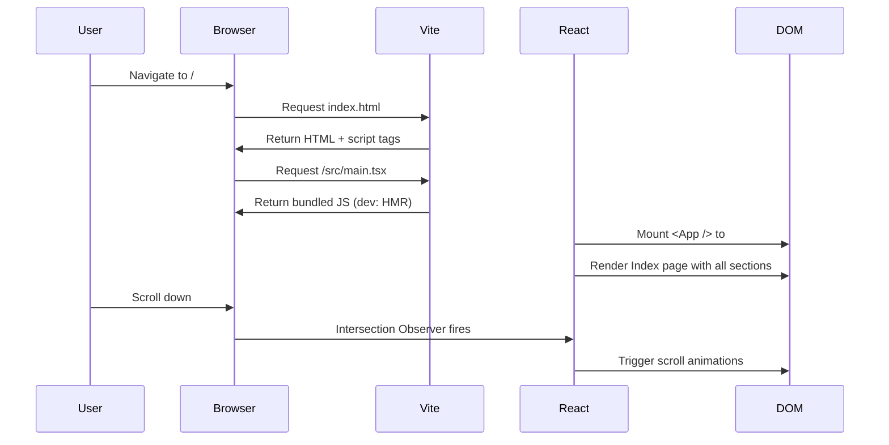
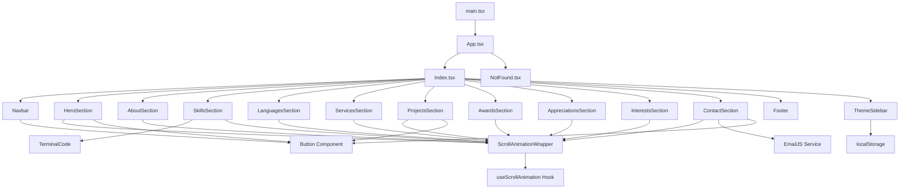

# Yash-portfolio
Portfolio Repository for Yashwanth-A-Kosuru

# Yashwanth A Kosuru — Full Stack Developer Portfolio

> A modern, animated, single-page portfolio application showcasing 4+ years of enterprise software development expertise in scalable distributed systems, cloud-native architectures, and microservices.

[](https://react.dev/)
[](https://www.typescriptlang.org/)
[](https://tailwindcss.com/)
[](https://vitejs.dev/)

---

## Table of Contents

1. [Project Overview](#1-project-overview)
2. [Tech Stack & Tooling](#2-tech-stack--tooling)
3. [Architecture Overview](#3-architecture-overview)
   - [High-Level Design (HLD)](#31-high-level-design-hld)
   - [Low-Level Design (LLD)](#32-low-level-design-lld)
4. [Folder Structure](#4-folder-structure)
5. [Component & Section Breakdown](#6-component--section-breakdown)
6. [Styling & Design System](#7-styling--design-system)
7. [Animations & Interactions](#8-animations--interactions)
8. [Local Setup & Development Guide](#9-local-setup--development-guide)
9. [Performance, Accessibility & SEO](#10-performance-accessibility--seo)
10. [Deployment & CI/CD](#11-deployment--cicd)
11. [Author & Links](#14-author--links)
12. [License](#15-license)

---

## 1. Project Overview

### Purpose

This portfolio is a professional showcase of **Yashwanth A Kosuru**, a Full Stack Developer with expertise in:

- **Backend Engineering**: Java, Spring Boot, GraphQL, Microservices, Node.js, Apollo Federation
- **Cloud & DevOps**: AWS, GCP, Kubernetes, Docker, CI/CD pipelines
- **Frontend Development**: React.js, Angular, TypeScript
- **Database Technologies**: PostgreSQL, MySQL, MongoDB, Redis, Firestore

### Problem Solved

Traditional static resumes fail to convey the depth of technical expertise and project complexity. This portfolio solves that by providing:

1. **Interactive Sections**: Engaging animations that demonstrate frontend proficiency
2. **Project Deep-Dives**: Detailed breakdowns of enterprise projects with tech stacks
3. **Contact Integration**: Direct email functionality via EmailJS
4. **Theme Flexibility**: Light/Dark/System theme support
5. **Responsive Design**: Optimized for mobile, tablet, and desktop viewports

### Key Features

- 🎨 **Neon-Blue Dark Theme** with glassmorphism effects
- ⚡ **Smooth Scroll Animations** using Intersection Observer
- 💻 **Terminal Code Animation** showcasing developer identity
- 🎯 **SEO Optimized** with meta tags and semantic HTML
- 📧 **EmailJS Integration** for contact form submissions
- 🌙 **Theme Switcher** with system preference detection

---

## 2. Tech Stack & Tooling

| Category | Technology | Version | Purpose |
|----------|-----------|---------|---------|
| **Framework** | React | 18.3.1 | Component-based UI library with hooks |
| **Language** | TypeScript | 5.x | Type-safe JavaScript superset |
| **Build Tool** | Vite | 5.x | Fast HMR and optimized production builds |
| **Styling** | Tailwind CSS | 3.x | Utility-first CSS framework |
| **Component Library** | shadcn/ui | Latest | Accessible, customizable UI primitives |
| **Routing** | React Router | 6.30.1 | Client-side SPA routing |
| **State Management** | TanStack Query | 5.83.0 | Server-state management (future-ready) |
| **Icons** | Lucide React | 0.462.0 | Tree-shakable icon library |
| **Email Service** | EmailJS | 4.4.1 | Client-side email sending |
| **Animations** | CSS Keyframes + Tailwind | - | Performant CSS-based animations |
| **Linting** | ESLint | 9.x | Code quality enforcement |
| **Package Manager** | npm/bun | - | Dependency management |

### Why These Choices?

- **React + Vite**: Fastest development experience with instant HMR
- **TypeScript**: Catches errors at compile-time, enhances IDE support
- **Tailwind CSS**: Eliminates context-switching between CSS files and components
- **shadcn/ui**: Owns the component code (no external dependency updates breaking UI)
- **Lucide Icons**: Modern Feather Icons fork with better TypeScript support
- **EmailJS**: No backend required for contact form functionality

---

## 3. Architecture Overview

### 3.1 High-Level Design (HLD)

```
┌─────────────────────────────────────────────────────────────────────────┐
│                           BROWSER                                        │
├─────────────────────────────────────────────────────────────────────────┤
│                                                                          │
│  ┌──────────────────────────────────────────────────────────────────┐   │
│  │                        React Application                          │   │
│  │                                                                   │   │
│  │  ┌─────────────┐  ┌─────────────┐  ┌─────────────┐              │   │
│  │  │   Routing   │  │   Context   │  │   Theming   │              │   │
│  │  │ (React      │  │ (QueryClient│  │ (CSS Vars)  │              │   │
│  │  │  Router)    │  │  + Tooltip) │  │             │              │   │
│  │  └─────────────┘  └─────────────┘  └─────────────┘              │   │
│  │                                                                   │   │
│  │  ┌─────────────────────────────────────────────────────────────┐ │   │
│  │  │                    Page Components                           │ │   │
│  │  │  ┌────────────────────────────────────────────────────────┐ │ │   │
│  │  │  │                    Index Page                           │ │ │   │
│  │  │  │                                                         │ │ │   │
│  │  │  │  ┌──────────┐ ┌──────────┐ ┌──────────┐ ┌──────────┐  │ │ │   │
│  │  │  │  │  Navbar  │ │   Hero   │ │  About   │ │  Skills  │  │ │ │   │
│  │  │  │  └──────────┘ └──────────┘ └──────────┘ └──────────┘  │ │ │   │
│  │  │  │                                                         │ │ │   │
│  │  │  │  ┌──────────┐ ┌──────────┐ ┌──────────┐ ┌──────────┐  │ │ │   │
│  │  │  │  │Languages │ │ Services │ │ Projects │ │  Awards  │  │ │ │   │
│  │  │  │  └──────────┘ └──────────┘ └──────────┘ └──────────┘  │ │ │   │
│  │  │  │                                                         │ │ │   │
│  │  │  │  ┌──────────┐ ┌──────────┐ ┌──────────┐ ┌──────────┐  │ │ │   │
│  │  │  │  │Appreciat.│ │Interests │ │ Contact  │ │  Footer  │  │ │ │   │
│  │  │  │  └──────────┘ └──────────┘ └──────────┘ └──────────┘  │ │ │   │
│  │  │  │                                                         │ │ │   │
│  │  │  │  ┌──────────────────────────────────────────────────┐  │ │ │   │
│  │  │  │  │              ThemeSidebar (Floating)             │  │ │ │   │
│  │  │  │  └──────────────────────────────────────────────────┘  │ │ │   │
│  │  │  └─────────────────────────────────────────────────────────┘ │ │   │
│  │  └─────────────────────────────────────────────────────────────┘ │   │
│  │                                                                   │   │
│  │  ┌─────────────────────────────────────────────────────────────┐ │   │
│  │  │                    UI Component Layer                        │ │   │
│  │  │  Button, Input, Textarea, Card, Toast, Tooltip, etc.       │ │   │
│  │  └─────────────────────────────────────────────────────────────┘ │   │
│  │                                                                   │   │
│  │  ┌─────────────────────────────────────────────────────────────┐ │   │
│  │  │                    Utilities & Hooks                         │ │   │
│  │  │  useScrollAnimation, useIsMobile, useTost, cn()            │ │   │
│  │  └─────────────────────────────────────────────────────────────┘ │   │
│  └──────────────────────────────────────────────────────────────────┘   │
│                                                                          │
├─────────────────────────────────────────────────────────────────────────┤
│                        EXTERNAL SERVICES                                 │
│  ┌─────────────────┐                                                    │
│  │     EmailJS     │ ← Contact form submissions                         │
│  └─────────────────┘                                                    │
└─────────────────────────────────────────────────────────────────────────┘
```

#### Rendering Flow



#### Deployment Flow

```
┌─────────────┐     ┌─────────────┐     ┌─────────────┐
│   GitHub    │────▶│   Vercel   │────▶│    CDN      │
│  Repository │     │   Platform  │     │  (Staging)  │
└─────────────┘     └─────────────┘     └─────────────┘
                           │
                           ▼
                    ┌─────────────┐
                    │  Production │
                    │   (*.app)   │
                    └─────────────┘
```

### 3.2 Low-Level Design (LLD)

#### Component Interaction Diagram



#### Data Flow Architecture

```
┌────────────────────────────────────────────────────────────────────┐
│                         Data Sources                                │
├────────────────────────────────────────────────────────────────────┤
│                                                                     │
│  ┌─────────────────┐  ┌─────────────────┐  ┌─────────────────┐    │
│  │  Static Arrays  │  │   Local State   │  │   localStorage  │    │
│  │  (Skills, etc.) │  │  (Form, Theme)  │  │   (Theme Pref)  │    │
│  └────────┬────────┘  └────────┬────────┘  └────────┬────────┘    │
│           │                    │                     │             │
│           ▼                    ▼                     ▼             │
│  ┌─────────────────────────────────────────────────────────────┐  │
│  │                    React Component Tree                      │  │
│  │                                                              │  │
│  │   Props Flow: Parent → Child (unidirectional)               │  │
│  │   State Flow: useState/useEffect for local state            │  │
│  │                                                              │  │
│  └─────────────────────────────────────────────────────────────┘  │
│                              │                                     │
│                              ▼                                     │
│  ┌─────────────────────────────────────────────────────────────┐  │
│  │                     External Services                        │  │
│  │                                                              │  │
│  │   EmailJS: Contact form → Email delivery                    │  │
│  │                                                              │  │
│  └─────────────────────────────────────────────────────────────┘  │
└────────────────────────────────────────────────────────────────────┘
```

#### Animation Lifecycle

```
┌──────────────────────────────────────────────────────────────────┐
│                     Animation System                              │
├──────────────────────────────────────────────────────────────────┤
│                                                                   │
│  ┌─────────────┐     ┌─────────────┐     ┌─────────────┐        │
│  │   Scroll    │────▶│ Intersection│────▶│  isVisible  │        │
│  │   Event     │     │  Observer   │     │   State     │        │
│  └─────────────┘     └─────────────┘     └─────────────┘        │
│                                                  │                │
│                                                  ▼                │
│                                          ┌─────────────┐         │
│                                          │   Apply     │         │
│                                          │  Transform  │         │
│                                          │  + Opacity  │         │
│                                          └─────────────┘         │
│                                                                   │
│  Animation Types:                                                 │
│  ├── One-time: ScrollAnimationWrapper (fade-in on scroll)       │
│  ├── Looping: float-continuous, pulse-glow-continuous           │
│  └── Interactive: TerminalCode (typing effect)                  │
│                                                                   │
└──────────────────────────────────────────────────────────────────┘
```

#### Reusability Strategy

| Pattern | Implementation | Benefit |
|---------|---------------|---------|
| **Wrapper Components** | `ScrollAnimationWrapper` | Reusable scroll animation for any child |
| **Custom Hooks** | `useScrollAnimation`, `useIsMobile` | Logic reuse across components |
| **UI Primitives** | shadcn/ui components | Consistent, accessible base components |
| **Design Tokens** | CSS Variables in `index.css` | Single source of truth for theming |
| **Utility Functions** | `cn()` for class merging | Clean conditional class handling |

---

## 4. Folder Structure

```
portfolio/
├── public/                          # Static assets served at root
│   ├── assets/                      # 3D model files (GLB format)
│   │   └── developer.png
|   |   └── Resume & CV Files
│   ├── favicon.ico                  # Browser tab icon
│
├── src/                             # Source code root
│   ├── assets/                      # Imported static assets
│   │   └── developer-avatar.png     # Hero section profile image
|   |   └── Other Images used for Projects, Awards, Achievements
│   │
│   ├── components/                  # React components
│   │   ├── ui/                      # shadcn/ui primitives (50+ components)
│   │   │   ├── button.tsx           # Button with custom variants
│   │   │   ├── input.tsx            # Form input component
│   │   │   ├── textarea.tsx         # Multi-line text input
│   │   │   ├── toast.tsx            # Notification toasts
│   │   │   ├── toaster.tsx          # Toast container
│   │   │   └── ...                  # Other UI primitives
│   │   │
│   │   ├── AboutSection.tsx         # About me content + floating icons
│   │   ├── AppreciationsSection.tsx # Testimonials carousel
│   │   ├── AwardsSection.tsx        # Awards grid with image carousel
│   │   ├── ContactSection.tsx       # Contact form + EmailJS
│   │   ├── Footer.tsx               # Site footer with social links
│   │   ├── HeroSection.tsx          # Landing hero with avatar
│   │   ├── InterestsSection.tsx     # Hobbies/interests grid
│   │   ├── LanguagesSection.tsx     # Language proficiency bars
│   │   ├── Navbar.tsx               # Fixed navigation header
│   │   ├── NavLink.tsx              # React Router NavLink wrapper
│   │   ├── ProjectsSection.tsx      # Project showcase cards
│   │   ├── ScrollAnimationWrapper.tsx # Scroll animation HOC
│   │   ├── ServicesSection.tsx      # Services bento grid
│   │   ├── SkillsSection.tsx        # Skills by category + terminal
│   │   ├── TerminalCode.tsx         # Typing animation terminal
│   │   └── ThemeSidebar.tsx         # Theme switcher sidebar
│   │
│   ├── hooks/                       # Custom React hooks
│   │   ├── use-mobile.tsx           # Mobile breakpoint detection
│   │   ├── use-toast.ts             # Toast notification hook
│   │   └── useScrollAnimation.tsx   # Intersection Observer hook
│   │
│   ├── lib/                         # Utility functions
│   │   └── utils.ts                 # cn() class merge utility
│   │
│   ├── pages/                       # Route page components
│   │   ├── Index.tsx                # Main portfolio page
│   │   └── NotFound.tsx             # 404 error page
│   │
│   ├── App.css                      # Legacy CSS (minimal usage)
│   ├── App.tsx                      # Root component with providers
│   ├── index.css                    # Global styles + design tokens
│   ├── main.tsx                     # Application entry point
│
├── .gitignore                       # Git ignore patterns
├── components.json                  # shadcn/ui configuration
├── eslint.config.js                 # ESLint configuration
├── index.html                       # HTML entry point + SEO meta
├── package.json                     # Dependencies + scripts
├── postcss.config.js                # PostCSS configuration
├── README.md                        # readme documentation of this project
├── tailwind.config.ts               # Tailwind configuration
├── tsconfig.json                    # TypeScript base config
├── tsconfig.app.json                # App-specific TS config
├── tsconfig.node.json               # Node.js TS config
└── vite.config.ts                   # Vite bundler configuration
```

### Folder Responsibilities

| Folder | Responsibility |
|--------|---------------|
| `public/` | Static files served directly without processing |
| `src/assets/` | Assets imported into components (bundled by Vite) |
| `src/components/` | All React components organized by feature |
| `src/components/ui/` | Reusable UI primitives from shadcn/ui |
| `src/hooks/` | Custom hooks for shared stateful logic |
| `src/lib/` | Pure utility functions (no React) |
| `src/pages/` | Route-level page components |

---

## 5. Component & Section Breakdown

### Section Flow & Purpose

```
┌─────────────────────────────────────────────────────────────────┐
│                        NAVIGATION LAYER                          │
│  Navbar: Fixed header with glass effect, mobile menu            │
│  ThemeSidebar: Floating theme switcher (right side)             │
└─────────────────────────────────────────────────────────────────┘
                              │
                              ▼
┌─────────────────────────────────────────────────────────────────┐
│                        HERO SECTION                              │
│  First impression • Name • Title • CTAs • Avatar                │
│  Animations: Floating icons, pulsing availability dot           │
└─────────────────────────────────────────────────────────────────┘
                              │
                              ▼
┌─────────────────────────────────────────────────────────────────┐
│                        ABOUT SECTION                             │
│  Personal story • Highlights • Education • Location             │
│  Animations: Floating tech icons, scroll fade-in                │
└─────────────────────────────────────────────────────────────────┘
                              │
                              ▼
┌─────────────────────────────────────────────────────────────────┐
│                        SKILLS SECTION                            │
│  Technical expertise • Categorized skills • Terminal demo       │
│  Animations: Skill tag hover, typing effect                     │
└─────────────────────────────────────────────────────────────────┘
                              │
                              ▼
┌─────────────────────────────────────────────────────────────────┐
│                        LANGUAGES SECTION                         │
│  Multilingual capability • Proficiency visualization            │
│  Animations: Progress bar fill on scroll                        │
└─────────────────────────────────────────────────────────────────┘
                              │
                              ▼
┌─────────────────────────────────────────────────────────────────┐
│                        SERVICES SECTION                          │
│  What I offer • Service cards • Bento layout                    │
│  Animations: Card hover effects, gradient borders               │
└─────────────────────────────────────────────────────────────────┘
                              │
                              ▼
┌─────────────────────────────────────────────────────────────────┐
│                        PROJECTS SECTION                          │
│  Portfolio • Tech stacks • Key highlights                       │
│  Animations: Image zoom on hover, card lift                     │
└─────────────────────────────────────────────────────────────────┘
                              │
                              ▼
┌─────────────────────────────────────────────────────────────────┐
│                        AWARDS SECTION                            │
│  Recognition • Achievement cards • Image carousel               │
│  Animations: Carousel transitions, featured slider              │
└─────────────────────────────────────────────────────────────────┘
                              │
                              ▼
┌─────────────────────────────────────────────────────────────────┐
│                        APPRECIATIONS SECTION                     │
│  Social proof • Testimonials • Credibility                      │
│  Animations: Quote fade-in, card hover                          │
└─────────────────────────────────────────────────────────────────┘
                              │
                              ▼
┌─────────────────────────────────────────────────────────────────┐
│                        INTERESTS SECTION                         │
│  Personal side • Hobbies • Relatability                         │
│  Animations: Icon scale on hover, glow effect                   │
└─────────────────────────────────────────────────────────────────┘
                              │
                              ▼
┌─────────────────────────────────────────────────────────────────┐
│                        CONTACT SECTION                           │
│  Call to action • Form • Contact info                           │
│  Animations: Availability pulse, form transitions               │
└─────────────────────────────────────────────────────────────────┘
                              │
                              ▼
┌─────────────────────────────────────────────────────────────────┐
│                        FOOTER                                    │
│  Branding • Social links • Copyright                            │
└─────────────────────────────────────────────────────────────────┘
```

---

## 6. Styling & Design System

### Color System

The design uses HSL color values stored as CSS custom properties for theme flexibility:

| Token | Dark Theme Value | Purpose |
|-------|-----------------|---------|
| `--background` | 220 30% 6% | Page background |
| `--foreground` | 210 40% 98% | Primary text |
| `--primary` | 195 100% 50% | Neon blue accent |
| `--secondary` | 220 20% 14% | Secondary surfaces |
| `--muted` | 220 20% 14% | Muted backgrounds |
| `--muted-foreground` | 215 20% 65% | Secondary text |
| `--card` | 220 25% 10% | Card backgrounds |
| `--border` | 220 20% 18% | Border color |
| `--destructive` | 0 84.2% 60.2% | Error states |

### Theme Strategy

```typescript
// ThemeSidebar.tsx applies themes by modifying CSS variables
const applyTheme = (mode: ThemeMode) => {
  const root = document.documentElement;
  
  if (effectiveTheme === 'light') {
    root.style.setProperty('--background', '0 0% 98%');
    root.style.setProperty('--foreground', '220 30% 10%');
    // ... 15+ more properties
  } else {
    // Dark theme values
  }
  
  localStorage.setItem('theme-mode', mode);
};
```

### Typography

| Type | Font | Usage |
|------|------|-------|
| Display | Space Grotesk | Headings, hero text |
| Body | Inter | Paragraphs, UI text |

```css
/* tailwind.config.ts */
fontFamily: {
  sans: ["Inter", "system-ui", "sans-serif"],
  display: ["Space Grotesk", "system-ui", "sans-serif"],
}
```

### Layout & Spacing

- **Container**: Max 1400px, centered, 2rem padding
- **Section Padding**: `py-16 md:py-24` (responsive)
- **Grid Gaps**: `gap-4 md:gap-6` (responsive)
- **Border Radius**: `--radius: 0.75rem` (12px default)

### Glassmorphism Effects

```css
.glass {
  @apply backdrop-blur-xl bg-card/50 border border-border/50;
}

.glass-card {
  background: var(--gradient-card);
  @apply backdrop-blur-xl border border-border/50;
}

.neon-border {
  @apply border border-primary/30;
  box-shadow: inset 0 0 20px hsl(195 100% 50% / 0.08), var(--glow-primary);
}
```

---

## 7. Animations & Interactions

### Animation Strategy

| Type | Implementation | Performance |
|------|----------------|-------------|
| Scroll Animations | Intersection Observer + CSS | GPU-accelerated (transform/opacity) |
| Looping Animations | CSS @keyframes | Hardware-accelerated |
| Interactive Hover | Tailwind transitions | No JS overhead |
| Typing Effect | setInterval + React state | Minimal DOM updates |

### Animation Categories

#### 1. One-Time Scroll Animations
```typescript
// ScrollAnimationWrapper.tsx
style={{
  opacity: isVisible ? 1 : 0,
  transform: isVisible ? 'translate(0)' : getTransform(),
  transition: `opacity 0.6s ease-out ${delay}ms, transform 0.6s ease-out ${delay}ms`,
}}
```

#### 2. Continuous Loop Animations
```css
/* index.css */
@keyframes float-continuous {
  0%, 100% { transform: translateY(0px); }
  50% { transform: translateY(-12px); }
}

.animate-float-continuous {
  animation: float-continuous 7s ease-in-out infinite;
}
```

#### 3. Event-Driven Animations
```typescript
// TerminalCode.tsx - Typing animation
useEffect(() => {
  const interval = setInterval(() => {
    // Character-by-character typing logic
  }, 30);
  return () => clearInterval(interval);
}, [isTyping, currentIndex, currentCharIndex]);
```

### Performance Considerations

- **GPU Acceleration**: Animations use `transform` and `opacity` only
- **Debounced Observers**: Intersection Observer with 10% threshold
- **Animation Delays**: Staggered delays prevent layout thrashing
- **Will-change**: Applied sparingly to animated elements
- **Reduced Motion**: Respects `prefers-reduced-motion` via Tailwind

---

## 8. Local Setup & Development Guide

### Prerequisites

- **Node.js**: v18.x or higher
- **npm**: v9.x or higher (or Bun v1.x)
- **Git**: Latest stable version

### Installation

```bash
# 1. Clone the repository
git clone <YOUR_GIT_URL>
cd <YOUR_PROJECT_NAME>

# 2. Install dependencies
npm install
# or
bun install

# 3. Start development server
npm run dev
# or
bun dev
```

### Available Scripts

| Script | Command | Purpose |
|--------|---------|---------|
| `dev` | `vite` | Start dev server with HMR |
| `build` | `tsc -b && vite build` | Production build |
| `preview` | `vite preview` | Preview production build |
| `lint` | `eslint .` | Run ESLint |

### Development Server

- **URL**: http://localhost:8080
- **Hot Module Replacement**: Enabled
- **Network Access**: Available on local network

### Environment Setup

No environment variables required for basic operation. EmailJS credentials are hardcoded (consider moving to env vars for production).

### Building for Production

```bash
# Create optimized production build
npm run build

# Preview locally
npm run preview
```

Output directory: `dist/`

---

## 9. Performance, Accessibility & SEO

### Performance Optimizations

| Optimization | Implementation |
|--------------|----------------|
| Code Splitting | Vite automatic chunk splitting |
| Tree Shaking | ES Modules + Lucide React |
| Image Optimization | Imported assets processed by Vite |
| CSS Purging | Tailwind JIT mode |
| Minimal JS | CSS-based animations where possible |
| Lazy Loading | Intersection Observer for sections |

### Accessibility Practices

- **Semantic HTML**: `<main>`, `<section>`, `<nav>`, `<footer>`
- **ARIA Labels**: Form inputs, interactive elements
- **Focus Management**: Visible focus rings on interactive elements
- **Color Contrast**: WCAG AA compliant in both themes
- **Keyboard Navigation**: Full keyboard accessibility
- **Screen Reader**: Alt text on images, semantic headings

### SEO Implementation

```html
<!-- index.html -->
<title>Yashwanth A Kosuru | Full Stack Developer</title>
<meta name="description" content="..." />
<meta name="keywords" content="..." />
<meta property="og:title" content="..." />
<meta property="og:description" content="..." />
<meta name="twitter:card" content="summary_large_image" />
<link rel="canonical" href="/" />
```

- **Single H1**: Hero section heading
- **Semantic Hierarchy**: Proper heading levels (H1 → H2 → H3)
- **robots.txt**: Allows all crawlers
- **Structured Data**: Open Graph + Twitter Cards

---

## 10. Deployment & CI/CD

### Hosting Provider

**Vercel Platform** - Integrated deployment with GitHub sync

### Deployment Flow

```
┌─────────────┐     ┌─────────────┐     ┌─────────────┐
│   Commit    │────▶│   Vercel   │────▶│   Build     │
│  to GitHub  │     │   Webhook   │     │   (Vite)    │
└─────────────┘     └─────────────┘     └─────────────┘
                                               │
                                               ▼
                                        ┌─────────────┐
                                        │   Deploy    │
                                        │   to CDN    │
                                        └─────────────┘
```

### Branch Strategy

- `main`: Production deployments
- Feature branches: Development and staging previews

### Manual Deployment Steps

1. Make changes in local editor and push to GitHub
2. Merge your changes till the main branch
3. Backend changes (if any) will deploy automatically

---

## 11. Author & Links

### Author
**Yashwanth A Kosuru**
- Full Stack Developer
- 4+ Years Experience
- Specializing in Enterprise Software, Microservices, Cloud-Native Architecture

### Links

| Platform | URL |
|----------|-----|
| **Portfolio** | [Live Site](https://yashwanth-a-kosuru.com) |
| **LinkedIn** | [linkedin.com/in/yashwanth-a-kosuru](https://www.linkedin.com/in/yashwanth-a-kosuru/) |
| **Email** | kosuruyashwanth@gmail.com |
| **Location** | Bahrain (Open to Relocation) |

---

## 12. License

This project is **private** and intended for personal portfolio use.

All rights reserved © 2024 Yashwanth A Kosuru

---

<div align="center">

**Built using React, TypeScript, and Tailwind CSS**

</div>